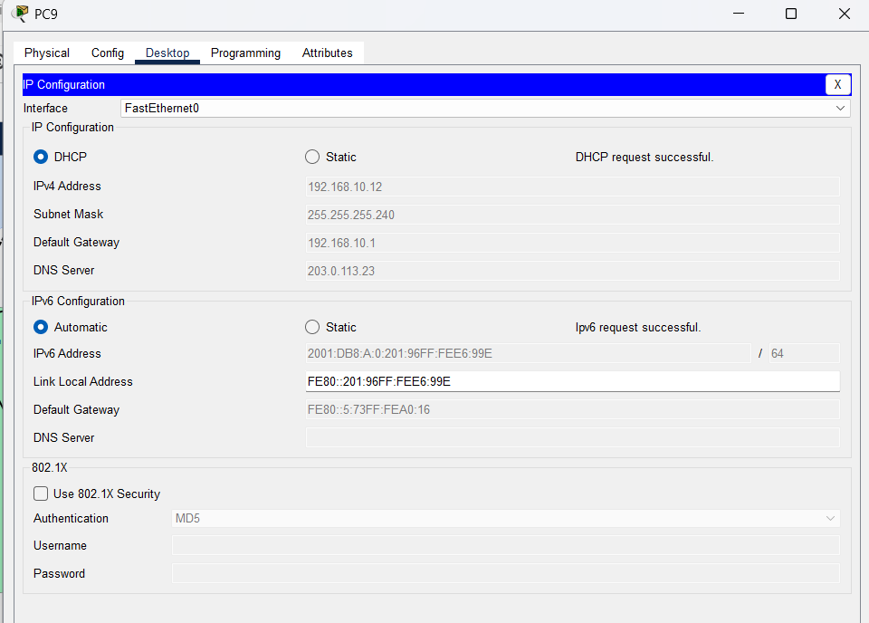
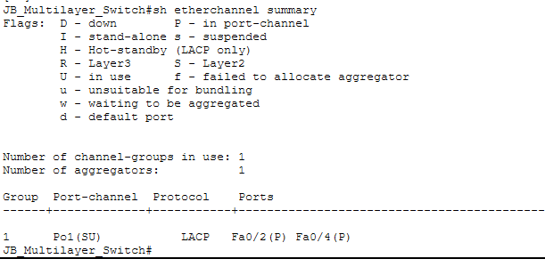
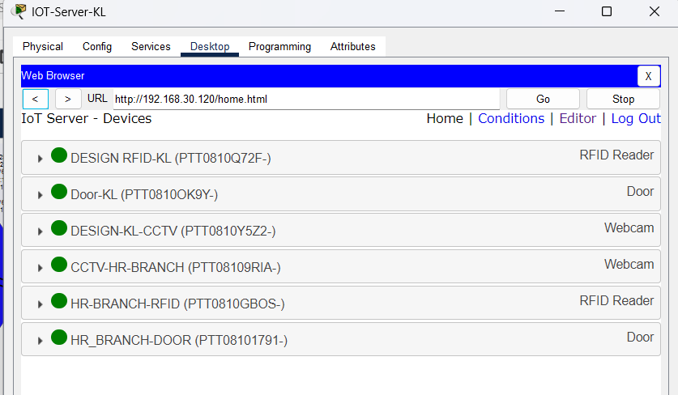

# Suzlon Enterprise Network

A multi-branch enterprise network built in Cisco Packet Tracer for a fictional company with four sites: **Kuala Lumpur (HQ), Malacca, Johor Bahru and Penang**. I designed the topology, planned the addressing (VLSM) and configured every device myself.

## 1. Overview

- 4 branches connected over WAN links, each with its own departments and VLANs
- Redundant core at KL (CoreA / CoreB) and redundant gateways at every branch
- Centralised services (DHCP, DNS, Web, FTP, Mail) in the JB server farm
- Layer 2 security on the access switches
- IoT devices (RFID readers, smart doors, CCTV) managed through IoT servers at KL and JB
- Status: core switching, routing, services, security and IoT **done**; wireless (WLC) **in progress**

## 2. Network Design

| Area | Design |
|---|---|
| Addressing | VLSM with private ranges per branch. Public-style addressing (203.0.113.0/24, documentation range) for WAN links and the server farm. IPv6 alongside IPv4 |
| Redundancy | HSRP at all 4 branches. KL uses CoreA/CoreB; Malacca, JB and Penang pair each router with a multilayer switch as HSRP active/standby for the department VLANs |
| Link aggregation | EtherChannel (LACP) between switches |
| Switching | VLANs, trunks, dual-homed access switches (verified with CDP), native VLAN 999 |
| Routing | OSPF between branches, default static route, inter-VLAN routing on multilayer switches |
| Services | DHCP (central server, per-VLAN pools, relay), DNS, Web, FTP, Mail |
| Security | Port security, DHCP snooping, Dynamic ARP Inspection on the access switches |
| IoT | RFID reader controls a door lock through rules on the IoT server (valid card unlocks, invalid card locks) |

Full address plan: [docs/addressing-table.md](docs/addressing-table.md)

## 3. Verification

Proof for each requirement, with screenshots: [docs/verification.md](docs/verification.md)

DHCP with IPv4 and IPv6 in a branch (KL Management):



EtherChannel (LACP) between the JB switches:



IoT server showing devices online at KL:



## 4. Repository Structure

```
Version_4_Enterprise/
├── README.md
├── packet-tracer/     Packet Tracer file
├── configs/           Configuration scripts
├── docs/              Addressing table and verification
└── screenshots/       Verification screenshots
```

## 5. How to Run

1. Install Cisco Packet Tracer.
2. Open the `.pkt` file in `packet-tracer/`.
3. Wait for the network to converge (about 1 minute).
4. On any PC, go to Desktop > IP Configuration > DHCP. It should receive an IPv4 address from its branch pool.
5. Verify with `ping` to the local gateway and to the DHCP server (203.0.113.22).

## 6. Challenges and What I Learned

| Problem | Cause | Fix | What I learned |
|---|---|---|---|
| Only some PCs received an IP | DHCP snooping was on with the DHCP server's port untrusted, and the pools overlapped switch management IPs | Disabled snooping to stabilise DHCP, then sized the pools to stop before the management IPs | Security features can break a working service. Add them one at a time and test after each |
| Native VLAN mismatch warnings between switches | Native VLAN 999 was set on one side of a trunk but not the other | Set the same native VLAN on both ends and disabled DTP negotiation | Trunk settings must match on both ends, and the CDP log shows where they do not |
| DHCP worked, then failed after a change | Stale leases and no saved copy to compare against | Cycled the DHCP service and kept a saved copy of the working file | Save a known-good version before every big change |
| Many branches and devices to keep consistent | Each branch repeats the same pattern (HSRP, VLANs, DHCP relay) | One addressing plan and one config pattern for all branches | A clear addressing plan up front prevents most mistakes later |

**Overall:** I troubleshoot from the bottom up (link, VLAN, gateway, service), change one thing at a time, and keep evidence of what works.

### Case study: intermittent DHCP

- **Symptom:** some HR and Management PCs got an address, others did not, and it changed between attempts.
- **Investigation:** static IPs could ping the gateway (HSRP VIP) and the DHCP server, so L2, uplinks and routing were fine. `show ip dhcp snooping` on the server switch showed snooping on for the server VLAN with only the uplinks trusted, so the server's own port was untrusted. The pools also ran up to the switch management addresses.
- **Fix:** disabled snooping on the server switch, reduced each pool's max users, and cycled the DHCP service to clear stale leases.
- **Next step:** trust the server-facing port and re-enable snooping.

## 7. Roadmap

- [x] VLANs, trunks, HSRP, EtherChannel, OSPF, inter-VLAN and inter-branch routing
- [x] DHCP (IPv4 and IPv6), DNS, Web, FTP, Mail
- [x] Port security, DHCP snooping, DAI
- [x] IoT / RFID devices
- [x] Wireless LAN controllers with WPA2 (JB and Penang)
- [x] Add full topology diagram and running-config dumps for the core devices

## Skills Demonstrated

VLSM, VLANs and trunking, HSRP, EtherChannel, OSPF, IPv6, DHCP and relay, Layer 2 security, IoT integration, network troubleshooting, technical documentation.
