# Verification and Configuration Evidence (Final)

Screenshots from the final Packet Tracer model. Files tagged `config` show configuration; files tagged `verify` show verification output.

## 1. Network topology

**Figure 2.1: Complete Suzlon Network Topology**

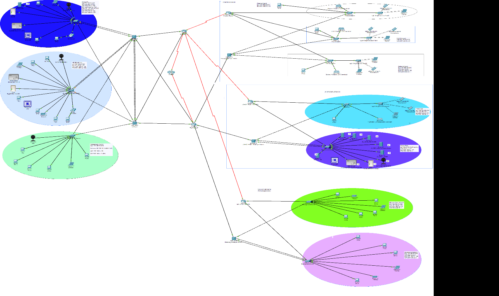

## 2a. LAN/WAN configuration: KL (HQ)

**Figure 4.1: KL Management Switch SSH and Basic Security Configuration**

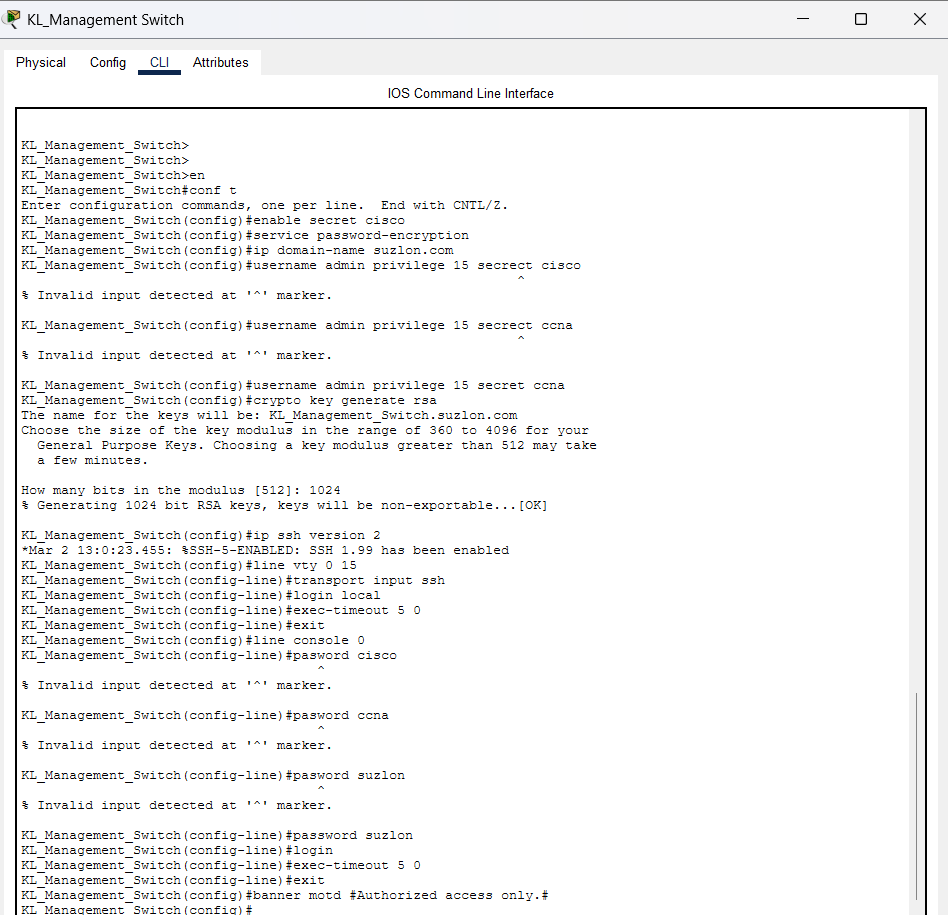

The screenshot shows security configuration on the KL Management Switch. Password encryption, SSH version 2, RSA keys, and transport input ssh are configured for secure remote access. Session timeout and login banner provide additional protection against unauthorised access.

**Figure 4.2: KL Management Switch SDM Dual IPv4 and IPv6 Configuration**

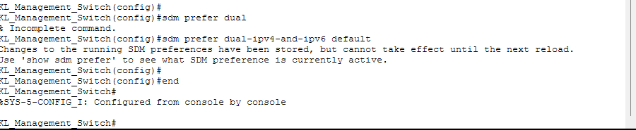

The screenshot shows SDM configuration using sdm prefer dual-ipv4-and-ipv6 default, enabling dual-stack IPv4/IPv6 support. The configuration is saved successfully but requires a switch restart to activate the new template.

**Figure 4.3: KL Management Switch VLAN 10 Management Interface Configuration**

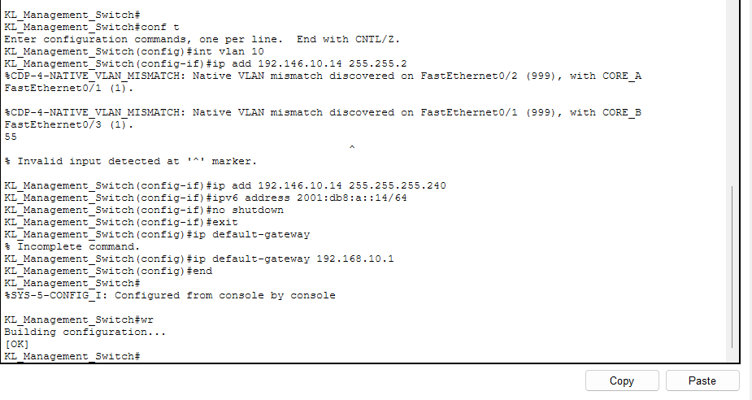

The screenshot shows the Management VLAN (VLAN 10) configuration on the KL Management Switch. The SVI is configured with IPv4 address 192.168.10.14/28 and IPv6 address 2001:db8:a::14/64 for dual-stack communication. The management IP allows remote switch access via SSH, while the default gateway 192.168.10.1 enables communication with other subnets.

**Figure 4.4: KL Management Switch VLAN and Trunk Verification**

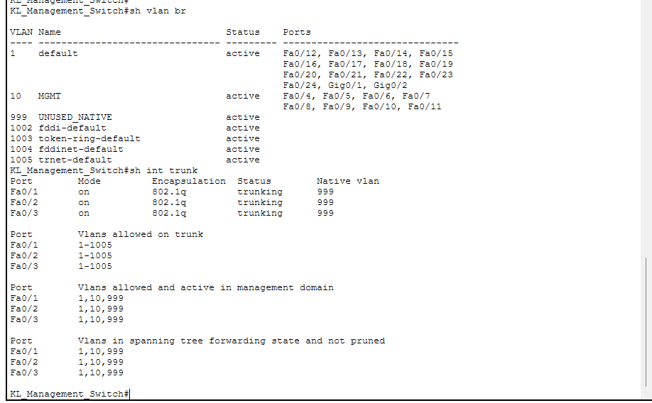

The show vlan brief and show interfaces trunk commands verify VLAN and trunk configuration. VLAN 10 (MGMT) is assigned to Fa0/4–Fa0/11, while VLAN 999 is configured as the native VLAN. Trunk links Fa0/1–Fa0/3 are confirmed as 802.1Q trunks for VLAN communication.

**Figure 4.5: KL Management Switch IP Interface Verification**

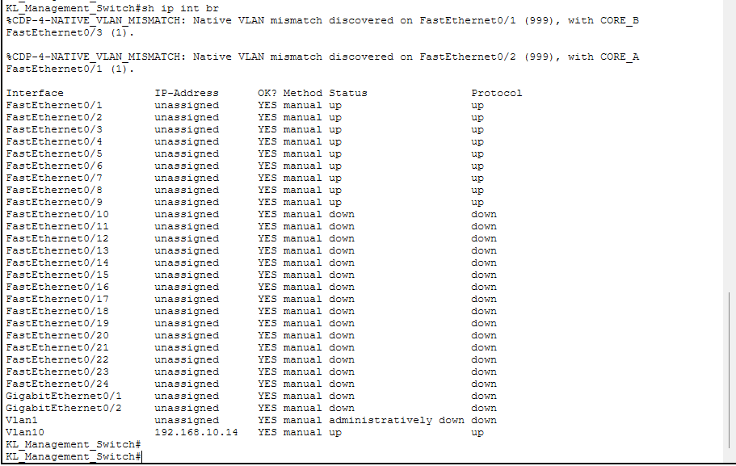

The show ip interface brief command verifies that VLAN 10 is configured with IPv4 address 192.168.10.14 and the interface status is up/up. The active trunk interfaces confirm successful communication between the KL Management Switch and core network.

**Figure 4.6: KL Human Resource Switch VLAN Configuration**

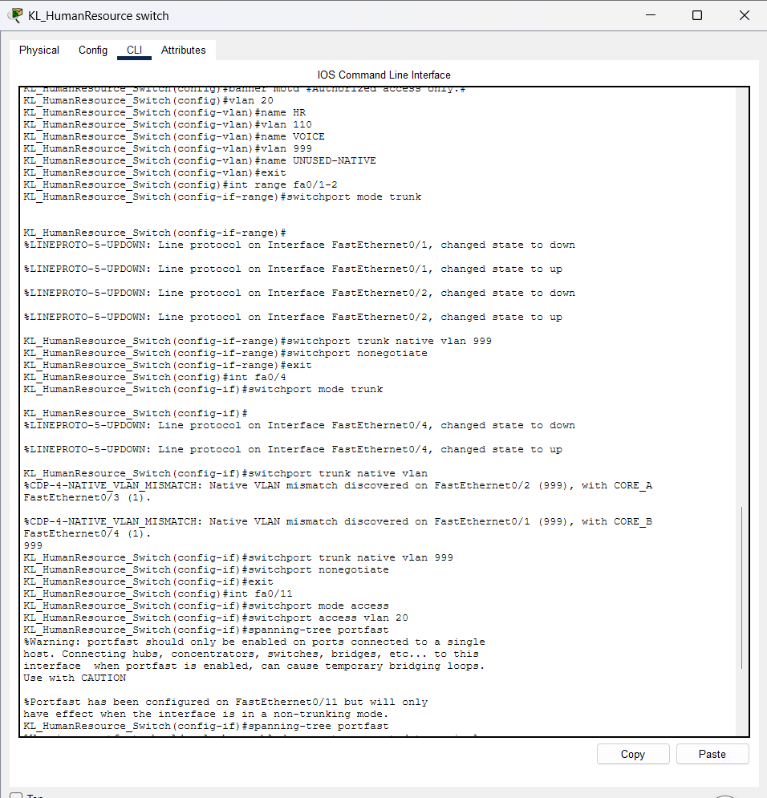

The screenshot shows VLAN configuration on the KL HR Switch. VLAN 20 (HR) is used for user traffic, VLAN 110 (Voice) for IP phones, and VLAN 999 as the native VLAN. Separating data and voice traffic improves network performance and management. All the uplink ports are configured as a trunk to enable multiple VLANs to communicate with the core switches. To enhance the security on layer 2, the native VLAN is reallocated to VLAN 999.

**Figure 4.7: KL Human Resource Switch VLAN and Trunk Verification**

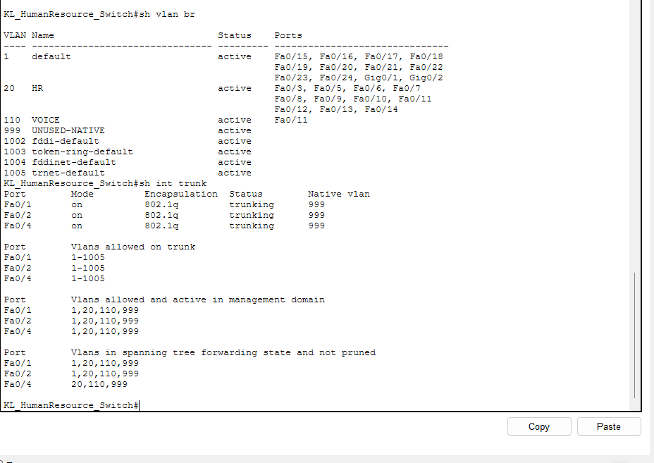

The show vlan brief and show interfaces trunk commands verify that VLAN 20 (HR), VLAN 110 (VOICE), and VLAN 999 (UNUSED-NATIVE) are active. The trunk links operate with 802.1Q encapsulation, allowing separated data and voice traffic to communicate through the core network.

**Figure 4.8: KL Human Resource Switch IPv4 and IPv6 Interface Verification**

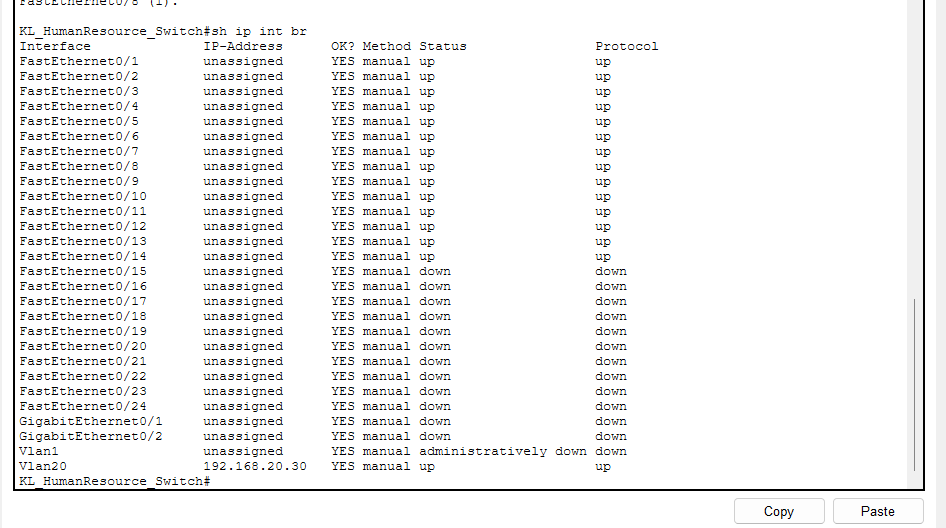

The command show ip interface brief is used to verify the IPv4 interface configuration on the KL Human Resource Switch. The output confirms that VLAN 20 is configured with the IPv4 address 192.168.20.30 and the interface status is up/up, indicating that the SVI is functioning correctly. This allows HR devices connected to VLAN 20 to communicate with the network gateway.

**Figure 4.9: KL Human Resource Switch IPv6 Interface Verification**

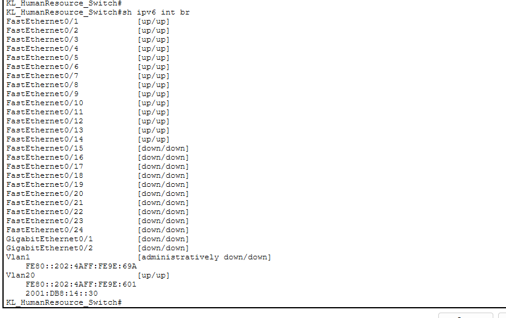

The show ipv6 interface brief command verifies IPv6 configuration on VLAN 20. The interface is active with link-local and global IPv6 addresses, confirming successful IPv6 operation on the HR network. IPv6 and IPv4 will coexist in the network and enabling the HR department to support both protocols.

**Figure 4.10: KL Design Switch SSH and Basic Security Configuration**

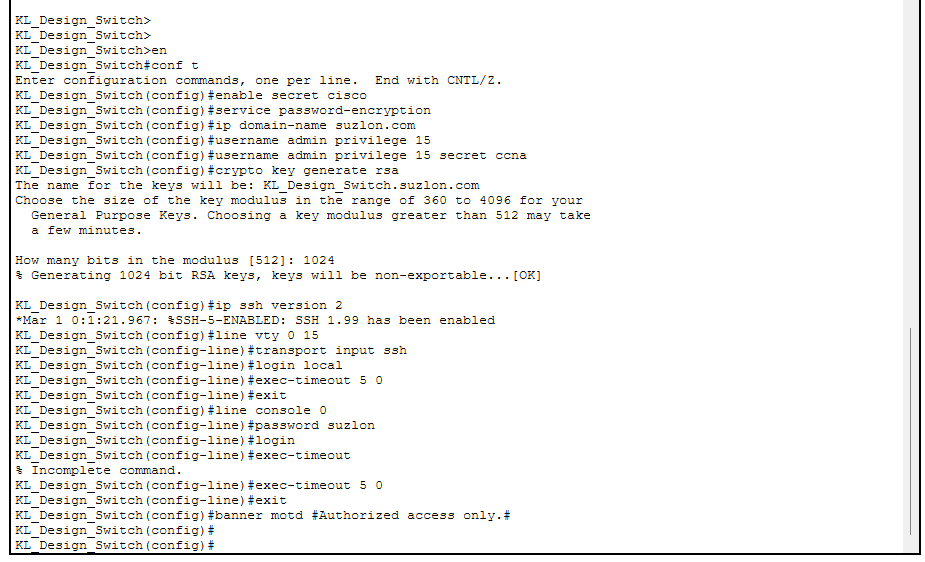

The screenshot shows the SSH security configuration implemented on the KL Design Switch for secure remote management. Password encryption is enabled using service password-encryption, while RSA keys and SSH version 2 are configured to provide encrypted remote access. The VTY lines are set to transport input ssh to allow only secure SSH connections. A session timeout and login banner are also configured to improve device security.

**Figure 4.11: KL Design Switch VLAN 30 Management Interface Configuration**

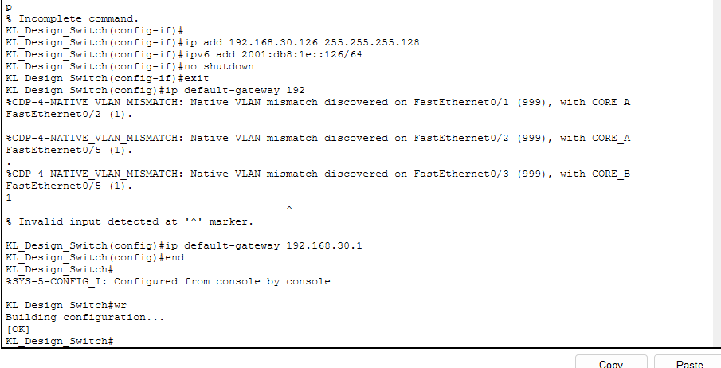

The screenshot shows VLAN 30 (DESIGN) configuration on the KL Design Switch. The SVI is configured with IPv4 192.168.30.126/25 and IPv6 2001:db8:1e::126/64 for dual-stack communication. This provides network segmentation and remote switch management for the Design department.

**Figure 4.12: KL Design Switch VLAN and Trunk Verification**

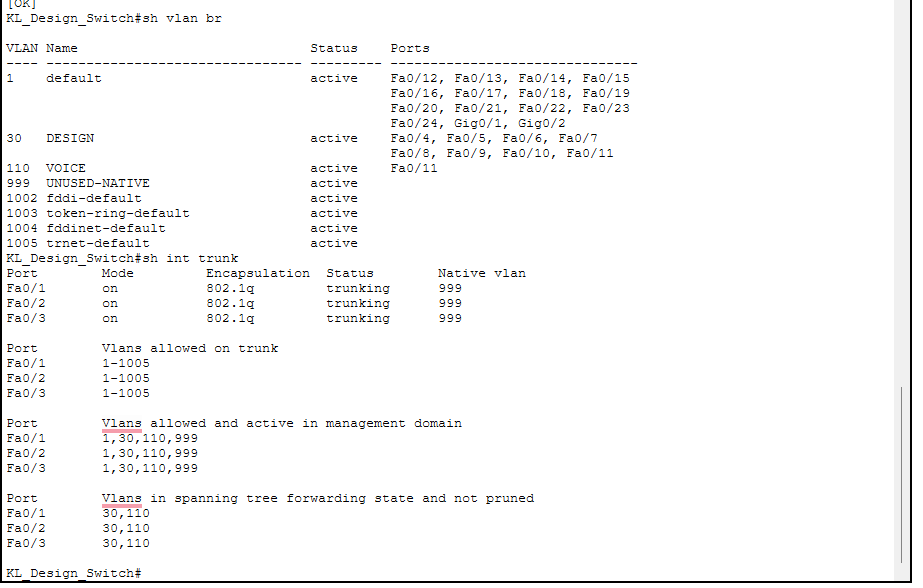

The show vlan brief and show interfaces trunk commands verify that VLAN 30 (DESIGN), VLAN 110 (VOICE), and VLAN 999 (UNUSED_NATIVE) are configured. The trunk ports Fa0/1–Fa0/3 operate as 802.1Q links, allowing VLAN traffic between the access and core switches.

**Figure 4.13: KL Design Switch IPv4 and IPv6 Interface Verification**

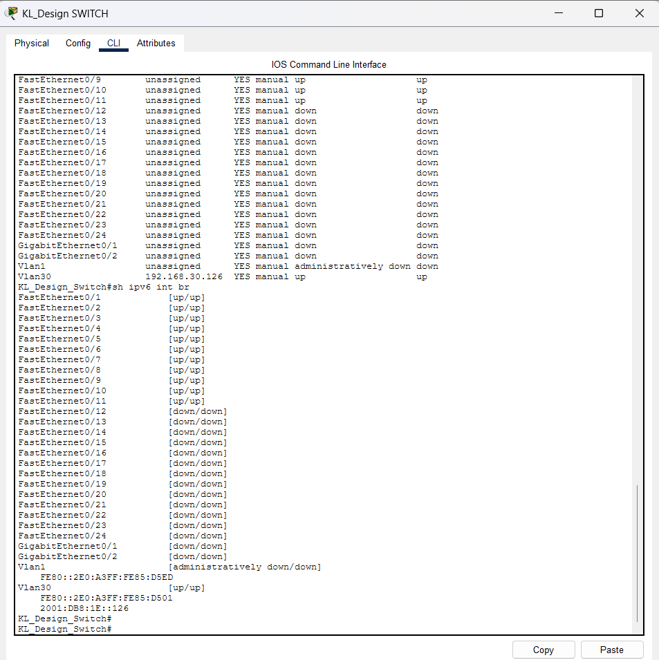

The show ip interface brief command verifies that VLAN 30 is configured with IPv4 address 192.168.30.126 and the interface status is up/up, confirming proper operation.

**Figure 4.14: CDP Neighbor Verification on CoreA**

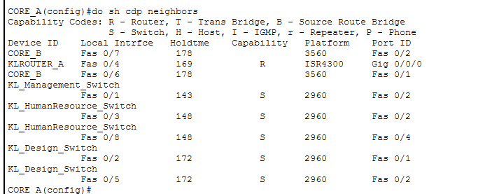

The screenshot shows the CDP neighbor verification on CoreA. The output confirms successful connections between CoreA and connected devices, including CoreB, KL Router, Management Switch, HR Switch, and Design Switch. This verifies that the LAN topology links are properly established.

**Figure 4.15: CoreA VLAN and Layer 3 Routing Configuration**

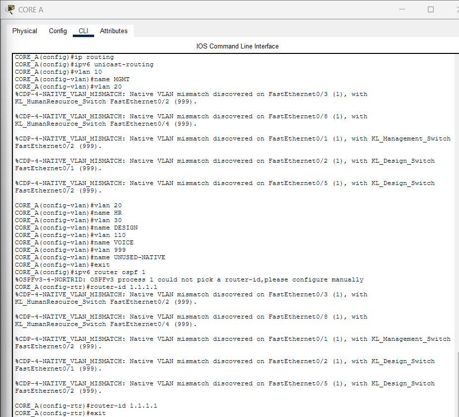

The screenshot shows the configuration of CoreA with IPv4 routing, IPv6 routing, and VLAN creation. VLANs 10, 20, 30, 110, and 999 are created to support different departments and services.

**Figure 4.16: CoreA HSRP Configuration for VLAN 20**

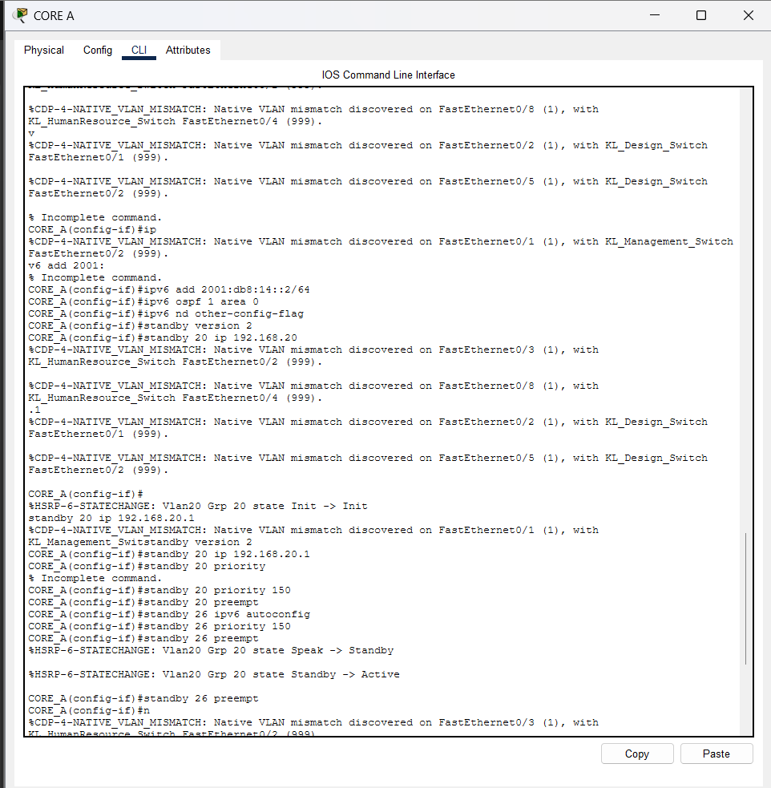

The screenshot shows HSRP configuration on VLAN 20. HSRP provides gateway redundancy by allowing CoreA to act as the active gateway for the HR VLAN.

**Figure 4.17: CoreA HSRP Configuration for VLAN 110**

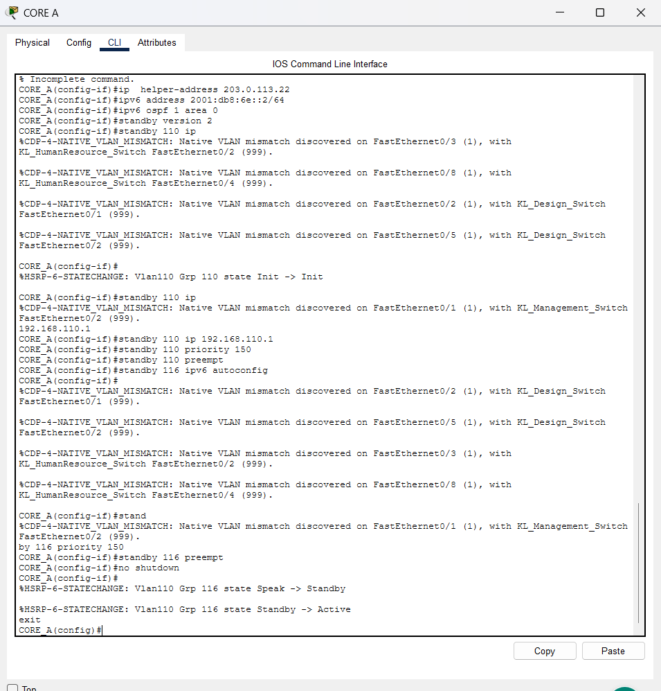

The screenshot shows HSRP configuration for VLAN 110 (Voice VLAN). The configuration provides gateway redundancy and improves network availability for voice communication.

**Figure 4.18: CoreA HSRP Status Verification**

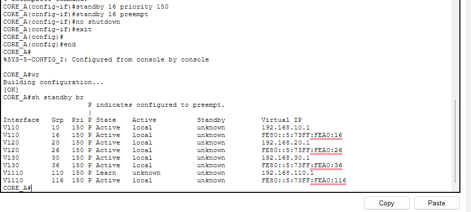

The show standby brief command verifies that HSRP is successfully configured. CoreA is shown as the active router with priority 150 for multiple VLANs.

**Figure 4.19: CoreA IPv6 Interface Verification**

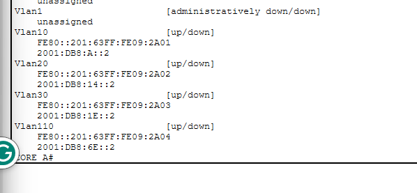

The screenshot verifies IPv6 configuration on CoreA using interface summary output. VLAN interfaces are configured with IPv6 addresses and are active for dual-stack communication.

**Figure 4.20: CoreA IPv4 Interface Verification**

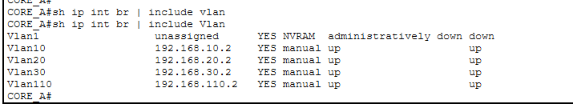

The screenshot verifies that VLAN interfaces on CoreA have been assigned IPv4 addresses and are in an up state, confirming successful Layer 3 SVI configuration.

**Figure 4.21: CoreA HSRP Verification**

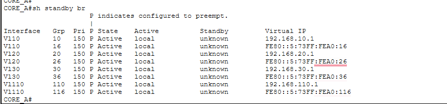

The show standby brief output confirms that HSRP virtual IP addresses are configured for VLANs 10, 20, 30, and 110, providing gateway redundancy.

**Figure 4.22: CoreA CDP Neighbor Verification**

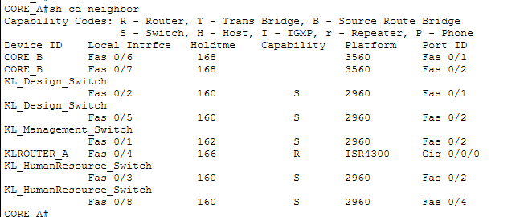

The screenshot shows CDP neighbor information on CoreA. It confirms successful connections with CoreB, KL Router, and access switches including Management, HR, and Design switches.

**Figure 4.23: CoreB HSRP Configuration**

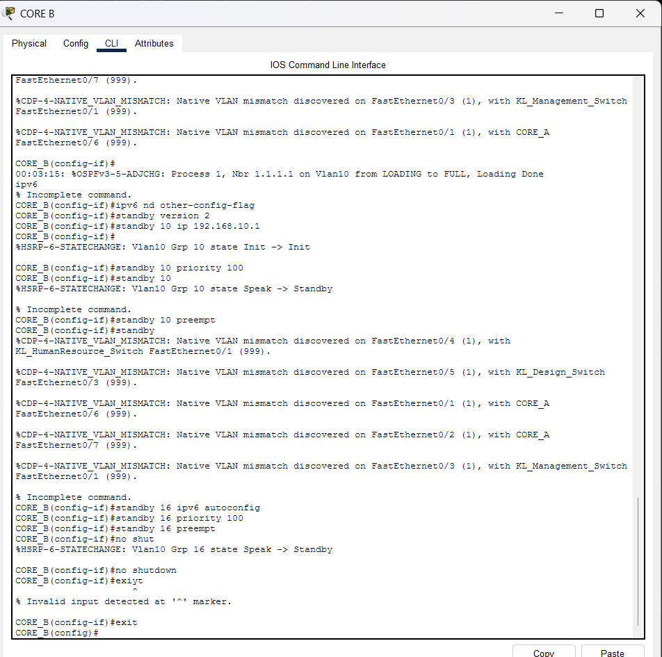

The screenshot shows the HSRP configuration on CoreB. CoreB is configured with lower priority to act as the standby multilayer switch and provide gateway redundancy with CoreA.

**Figure 4.24: CoreB VLAN and IPv6 Configuration**

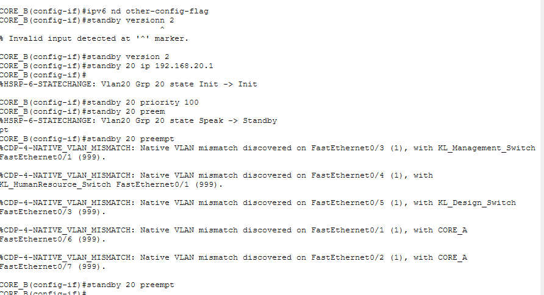

The screenshot shows the configuration of VLAN interfaces on CoreB, including IPv4, IPv6 addressing, OSPF, and HSRP settings for Management, HR, Design, and Voice VLANs.

**Figure 4.25: CoreB HSRP Verification**

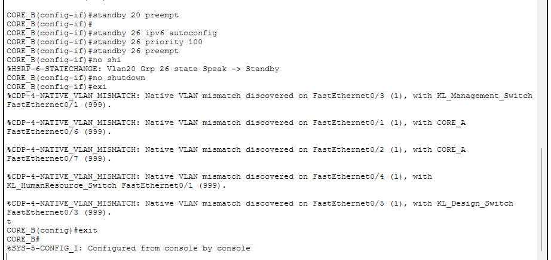

The command show standby brief verifies that HSRP is successfully configured. CoreB operates as the standby router for multiple VLAN gateways, ensuring network availability.

**Figure 4.26: CoreB EtherChannel Verification**

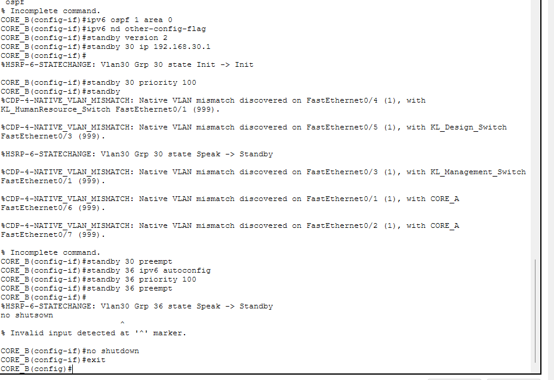

The command show etherchannel summary confirms that EtherChannel is successfully configured between CoreB and CoreA using LACP, providing link redundancy and increased bandwidth.

**Figure 4.27: CoreB OSPF Configuration**

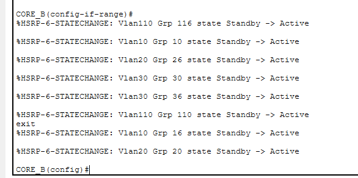

The screenshot shows OSPF configuration on CoreB. The router ID and network statements enable dynamic routing between VLAN networks and other locations.

**Figure 4.28: CoreB OSPF Neighbor Verification**

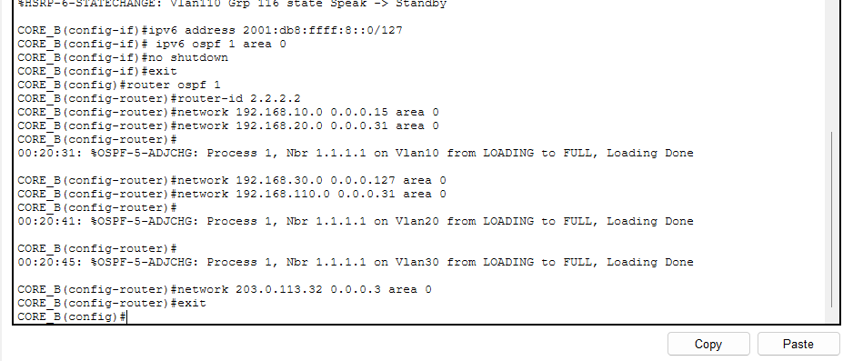

The OSPF neighbor verification confirms successful adjacency between CoreB and CoreA, allowing routing information exchange.

**Figure 4.29: CoreB Trunk Port Verification**

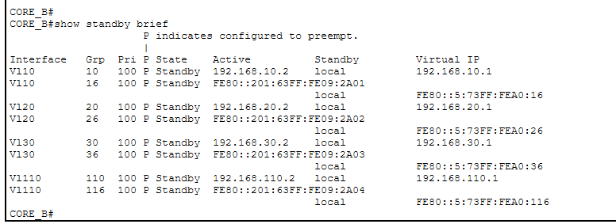

The command show interfaces trunk confirms that trunk links are active and using IEEE 802.1Q encapsulation with VLAN 999 as the native VLAN.

**Figure 4.30: CoreA and CoreB Interface Verification**

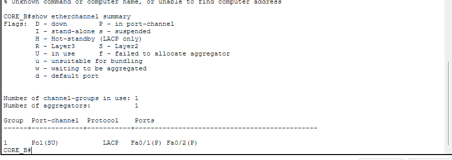

The screenshot verifies the Layer 3 interface status and IP configuration of the core switches, confirming that VLAN interfaces are active.

**Figure 4.31: CoreA OSPF Verification**

The screenshot shows the OSPF routing configuration on CoreA, including router ID and network advertisement for connected VLANs.

**Figure 4.32: CoreA OSPF Running Configuration**

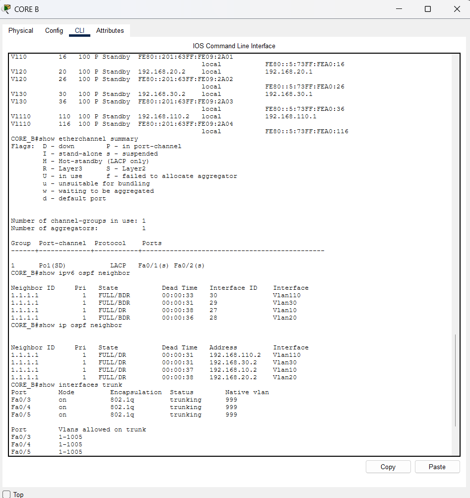

**Figure 4.33: CoreA OSPF Network Configuration**

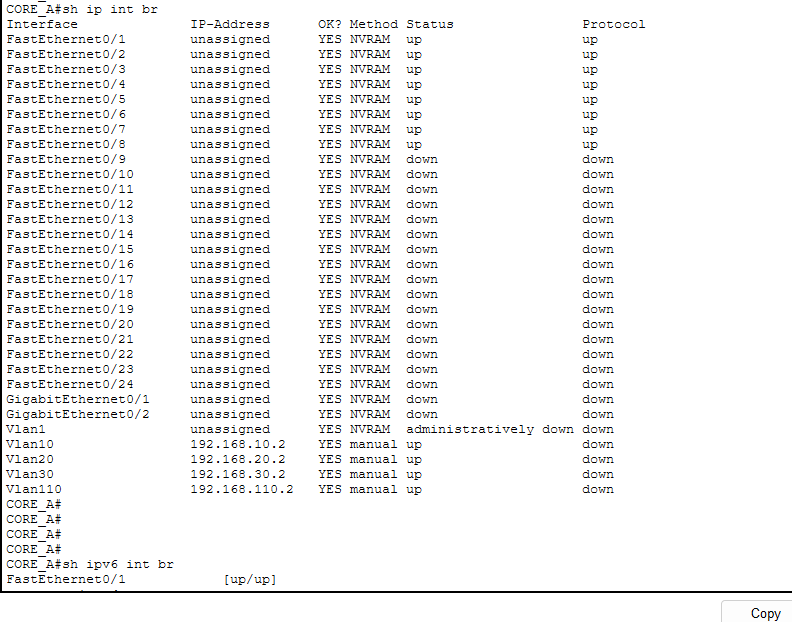

The screenshot shows the OSPF configuration on CoreA. The configured network statements advertise the connected VLANs and WAN network for dynamic routing.

**Figure 4.33: CoreA OSPF Network Configuration**

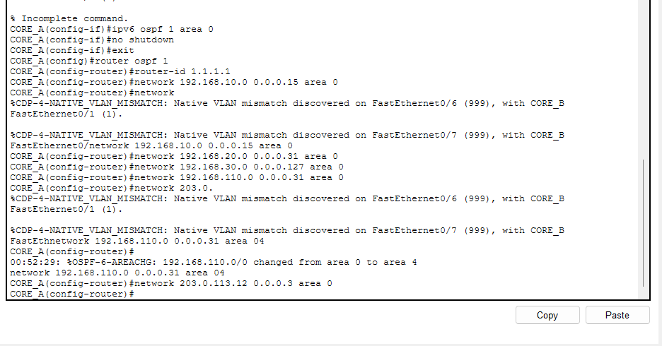

The screenshot shows the OSPF configuration on CoreA. The configured network statements advertise the connected VLANs and WAN network for dynamic routing.

**Figure 4.34: CoreA OSPF Running Configuration Verification**

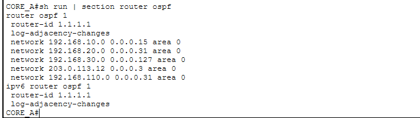

The command show running-config | section router ospf confirms that OSPF is enabled on CoreA with the correct router ID and network advertisements.

**Figure 4.35: KL Router_A Initial Security Configuration**

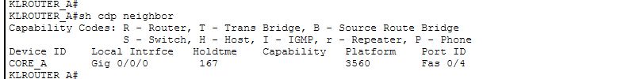

The screenshot shows the security configuration of KL Router_A, including password encryption, SSH access, RSA key generation, and secure remote management settings.

**Figure 4.36: KL Router_A WAN Interface Configuration**

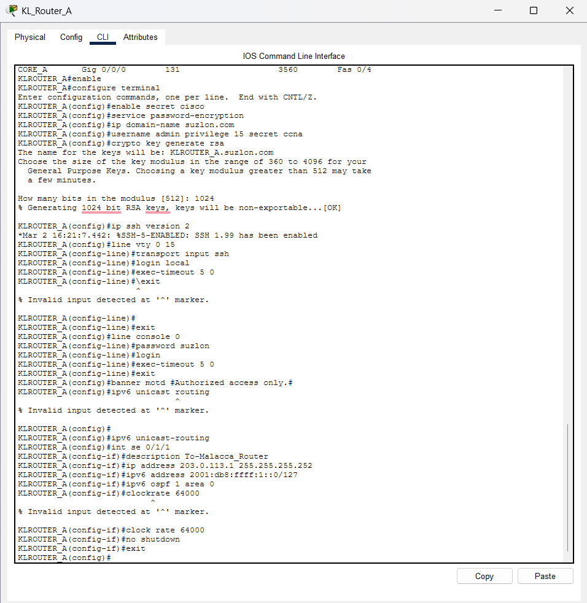

The screenshot shows the WAN interface configuration of KL Router_A. The router is connected to Malacca, JB, Penang, CoreA, and ISP using IPv4 and IPv6 addressing with OSPF enabled.

**Figure 4.37: KL Router_A Default Route and OSPF Configuration**

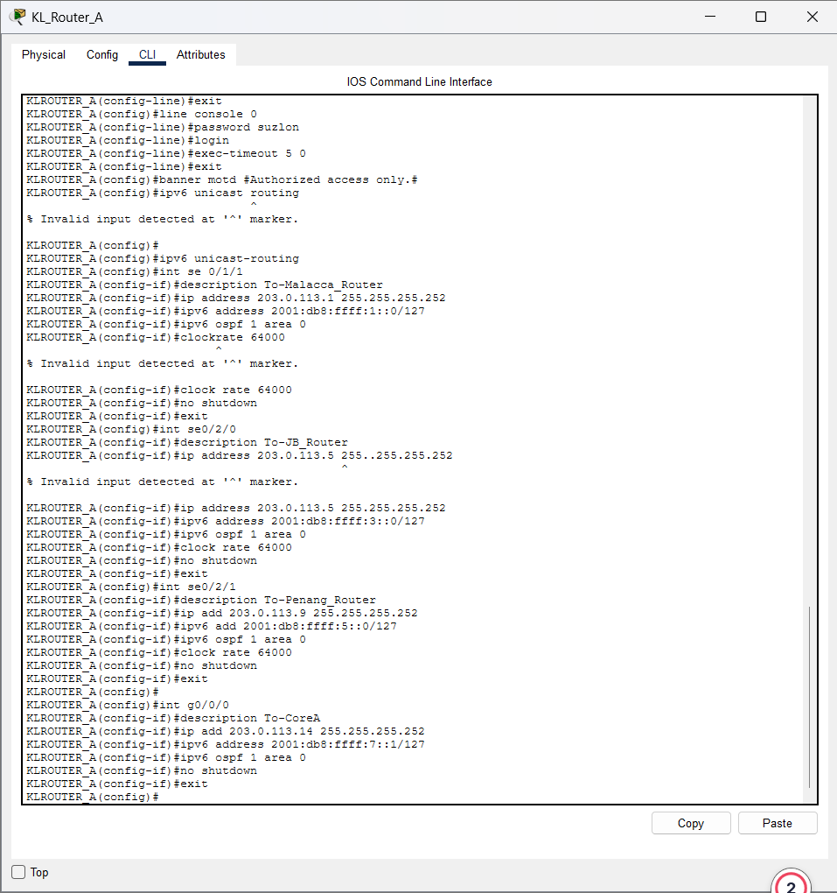

The screenshot verifies the default route and OSPF configuration on KL Router_A. OSPF provides dynamic routing between different network locations, while the default route enables external connectivity through the ISP.

**Figure 4.38: KL Router_A OSPF Neighbor Verification**

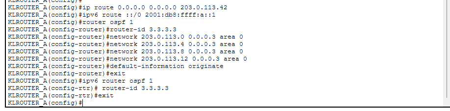

The screenshot verifies successful OSPF neighbor relationships and learned routes between KL Router_A and other network devices.

**Figure 4.39: KL Router_A OSPF Neighbor and Routing Table Verification**

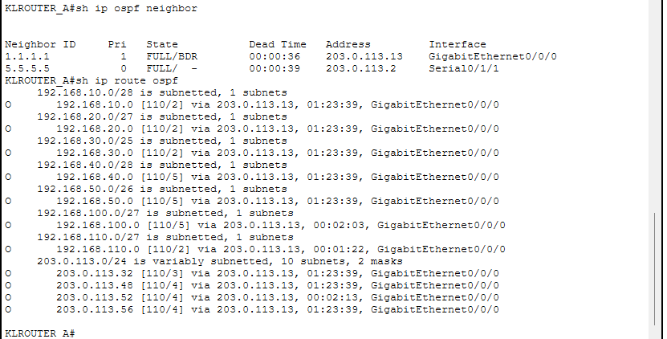

The screenshot verifies the OSPF neighbor relationship and routing table on KL Router_A. The output confirms successful OSPF communication with other network devices and shows the learned routes from different network segments.

**Figure 4.40: KL Router A OSPF Routing Table Verification**

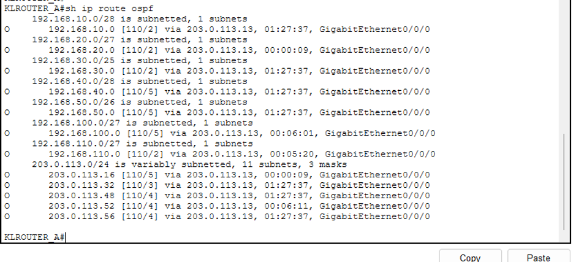

Shows learned OSPF routes from connected network segments.

**Figure 4.41: KL Router_B CDP Neighbor Verification**

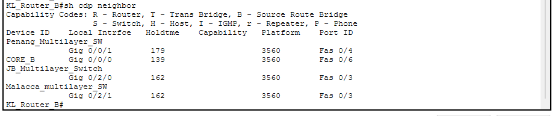

The screenshot verifies the connected devices of KL Router_B using the CDP neighbor command. It confirms successful connections with Core_B, Penang Multilayer Switch, JB Multilayer Switch, and Malacca Multilayer Switch.

**Figure 4.42: KL Router_B VLAN 201 and VLAN 202 Configuration Verification**

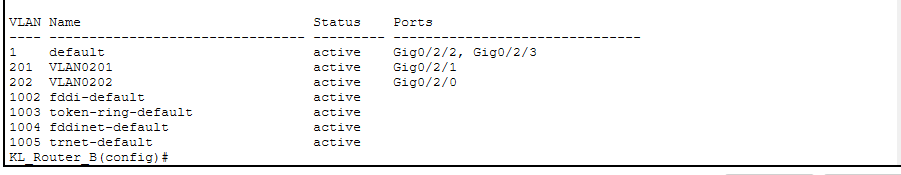

The screenshot verifies the creation of VLAN 201 and VLAN 202 on KL Router_B. These VLANs are used as Layer 2 connections for communication with Malacca and Johor Bahru Multilayer Switches.

## 2b. LAN/WAN configuration: Malacca

**Figure 4.43: Malacca Multilayer Switch VLAN 201 Configuration**

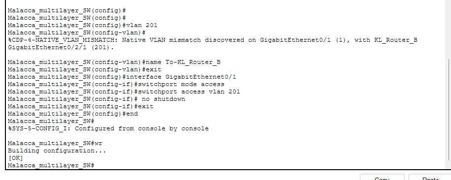

The screenshot shows the configuration of VLAN 201 on Malacca Multilayer Switch. GigabitEthernet0/1 is assigned to VLAN 201 to establish a connection with KL Router_B.

**Figure 4.44: JB Multilayer Switch VLAN 202 Configuration**

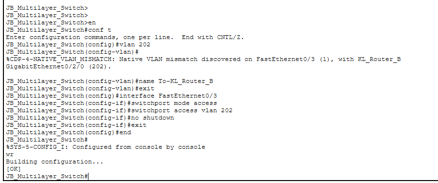

The screenshot shows the configuration of VLAN 202 on the JB Multilayer Switch. FastEthernet0/3 is assigned as an access port for VLAN 202 to establish connectivity with KL Router_B.

**Figure 4.45: Malacca Router VLAN 50 Development Interface HSRP Configuration**

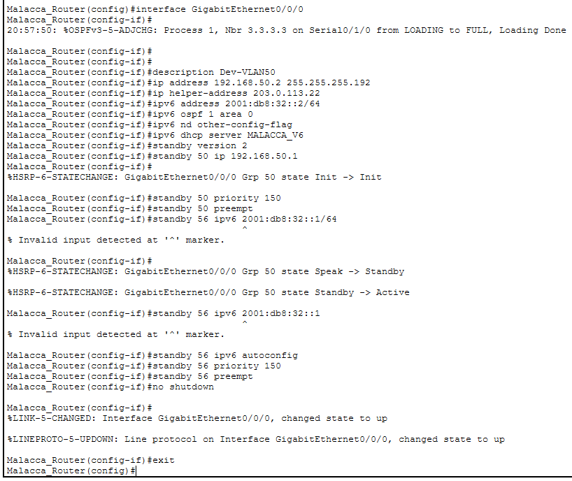

The screenshot shows the configuration of VLAN 50 on Malacca Router, including IP addressing, IPv6 settings, OSPF and HSRP active gateway configuration.

**Figure 4.46: Malacca Router OSPF Routing Configuration**

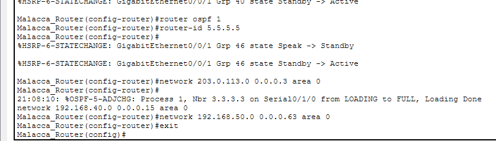

The screenshot shows the OSPF routing configuration on Malacca Router with router ID 5.5.5.5 and connected network advertisement.

**Figure 4.47: JB Multilayer Switch OSPF Routing Table Verification**

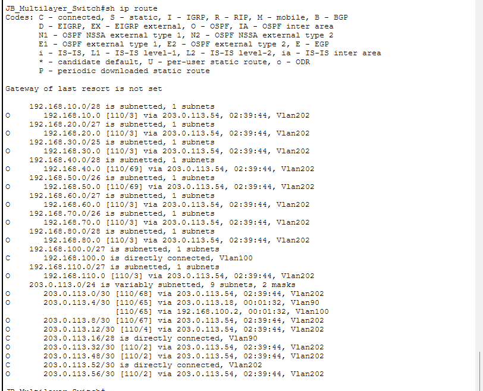

This figure verifies the OSPF routing table on the JB Multilayer Switch, showing successfully learned routes between network segments.

**Figure 4.48: Malacca Router HSRP and OSPF Verification**

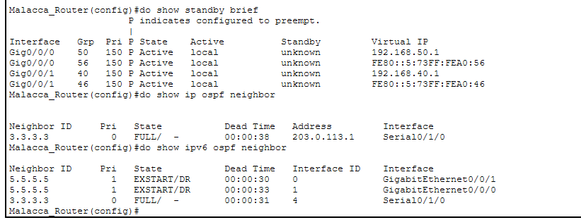

The screenshot verifies the successful operation of HSRP and OSPF on Malacca Router. The output confirms the active HSRP state and established IPv4 and IPv6 OSPF neighbor relationships.

**Figure 4.49: Malacca Multilayer Switch CDP Neighbor Verification**

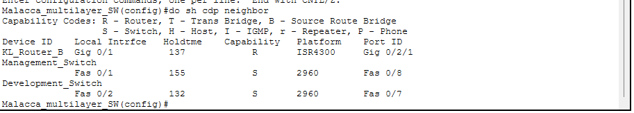

The screenshot verifies the connectivity between Malacca Multilayer Switch and connected network devices using CDP neighbor information.

**Figure 4.50: Malacca Multilayer Switch Interface Verification**

The screenshot verifies the status of interfaces and VLAN interfaces on Malacca Multilayer Switch after configuration.

**Figure 4.51: Malacca Multilayer Switch VLAN and HSRP Configuration**

The screenshot shows the configuration of VLAN interfaces on Malacca Multilayer Switch, including IP addressing, IPv6 settings, OSPF and HSRP standby configuration.

**Figure 4.52: Malacca Multilayer Switch Routed Interface Configuration**

The screenshot shows the Layer 3 routed interface configuration connecting Malacca Multilayer Switch to KL Router B using IPv4, IPv6 and OSPF.

**Figure 4.53: Malacca Multilayer Switch HSRP and OSPF Verification**

The screenshot confirms successful HSRP operation and established IPv4 and IPv6 OSPF neighbor relationships with KL Router B.

**Figure 4.54: Development Switch CDP Neighbor Verification**

The screenshot verifies the connectivity between Development Switch, Malacca Router and Malacca Multilayer Switch using CDP neighbor information.

**Figure 4.54: Development Switch CDP Neighbor Verification**

The screenshot verifies the connectivity between Development Switch, Malacca Router and Malacca Multilayer Switch using CDP neighbor information.

**Figure 4.55: Development Switch SSH Security Configuration**

The screenshot shows SSH security configuration on Development Switch, including RSA key generation and remote access setup.

**Figure 4.57: Malacca Management Switch VLAN and Trunk Verification**

This figure verifies VLAN 40 and VLAN 999 configuration and confirms that trunk interfaces are working properly.

**Figure 4.58: Development Switch VLAN 50 and Trunk Verification**

This figure verifies VLAN 50 configuration and confirms trunk connectivity between the switches.

**Figure 4.59: Malacca Router HSRP and OSPF Verification**

This figure confirms HSRP status and successful OSPF neighbor establishment on the Malacca Router.

**Figure 4.60: Malacca Multilayer Switch HSRP and OSPF Verification**

This figure verifies HSRP operation and OSPF connectivity on the Malacca Multilayer Switch.

**Figure 4.61: Malacca Management Switch VLAN Configuration**

The screenshot verifies the VLAN configuration on the Malacca Management Switch. VLAN 40 (Management) and VLAN 999 (UNUSED_NATIVE) are successfully created for network segmentation and Layer 2 security.

**Figure 4.62: Malacca Management Switch Layer 2 Security Configuration**

The screenshot shows Port Security, DHCP Snooping, and Dynamic ARP Inspection configuration on the Malacca Management Switch to prevent unauthorised access and Layer 2 attacks.

**Figure 4.63: Development Switch DHCP Snooping and ARP Inspection Verification**

The screenshot verifies DHCP Snooping and Dynamic ARP Inspection settings on the Development Switch with trusted uplink ports configured.

**Figure 4.63: Development Switch DHCP Snooping and ARP Inspection Verification**

The screenshot verifies DHCP Snooping and Dynamic ARP Inspection settings on the Development Switch with trusted uplink ports configured.

**Figure 4.64: Development Switch Access VLAN Correction**

This figure shows the correction of the Development Switch port configuration by assigning the correct access VLAN.

**Figure 4.65: Development Switch VLAN Configuration Verification**

This figure verifies the VLAN configuration on the Development Switch, confirming that VLAN 40 and VLAN 50 are active.

**Figure 4.66: Development Switch VLAN Access Port Correction**

This figure shows the correction of the Development Switch port configuration by changing the interface to access mode and assigning the correct VLAN.

## 2c. LAN/WAN configuration: Johor Bahru

**Figure 4.67: JB Multilayer Switch SSH Key Generation Configuration**

This figure shows the RSA key generation and SSH version configuration on the JB Multilayer Switch.

**Figure 4.68: JB Multilayer Switch SSH Line Configuration**

This figure verifies the SSH access configuration through VTY lines on the JB Multilayer Switch.

**Figure 4.69: JB Multilayer Switch SDM Dual IPv4 and IPv6 Configuration**

This figure shows the SDM configuration to support both IPv4 and IPv6 operations on the JB Multilayer Switch.

**Figure 4.70: JB Multilayer Switch HSRP VLAN 90 and VLAN 100 Configuration**

Shows HSRP configuration for VLAN 90 and VLAN 100 interfaces on JB Multilayer

**Figure 4.71: JB Multilayer Switch IPv6 Routing and HSRP Configuration**

Shows IPv6 routing enablement and HSRP setup for IPv6 networks.

**Figure 4.72: JB Multilayer Switch Interface Status Verification**

Verifies VLAN interfaces and confirms the configured IP addresses are active.

**Figure 4.73: JB Multilayer Switch HSRP Status Verification**

Shows HSRP status and confirms the active router state with virtual IP addresses.

**Figure 4.74: JB Multilayer Switch IPv6 OSPF Neighbor Verification**

Verifies successful IPv6 OSPF neighbor establishment with KL Router B.

**Figure 4.75: JB Multilayer Switch IPv4 OSPF Neighbor Verification**

Shows IPv4 OSPF neighbor connection between JB Multilayer Switch and KL Router B.

**Figure 4.76: JB Multilayer Switch OSPF Interface Verification**

Displays OSPF-enabled interfaces and their operational states.

**Figure 4.77: JB Multilayer Switch OSPF Interface Verification**

Shows the OSPF-enabled interfaces and their current operational states on the JB Multilayer Switch.

**Figure 4.78: IT Switch VLAN Configuration**

The screenshot verifies the VLAN configuration on the IT Switch. VLAN 100 (IT) and VLAN 999 (UNUSED_NATIVE) are configured to separate IT department traffic and improve network security.

**Figure 4.79: IT Switch DHCP Snooping Verification**

The verification confirms DHCP Snooping is enabled on the IT Switch with trusted uplink interfaces configured for legitimate DHCP traffic.

**Figure 4.80: Johor Baru Router Interface Configuration**

Shows the configured IP addresses and active interfaces on the Johor Baru Router.

**Figure 4.81: Johor Baru Router HSRP and OSPF Verification**

Verifies HSRP status and confirms OSPF neighbor connectivity with the network.

**Figure 4.82: Johor Baru Router HSRP Configuration**

Shows HSRP configuration for Server Farm VLAN and user VLAN interfaces.

**Figure 4.83: JB Multilayer Switch HSRP Standby Verification**

Shows HSRP status of JB Multilayer Switch operating as standby for VLAN networks.

**Figure 4.84: Johor Baru Router HSRP and OSPF Neighbor Verification**

Verifies HSRP status and confirms successful OSPF neighbor connections.

**Figure 4.85: Server Switch IPv6 Address Configuration**

Shows IPv6 address configuration on the Server Switch interface.

**Figure 4.86: Management Switch VLAN Verification**

Displays configured Management VLAN and assigned switch ports.

**Figure 4.87: Development Switch VLAN Verification**

Displays configured Development VLAN and assigned switch ports.

**Figure 4.88: Malacca Multilayer Switch Interface Verification**

Shows interface status and configured VLAN interfaces on Malacca Multilayer Switch.

**Figure 4.89: Malacca Multilayer Switch OSPF Neighbor Verification**

Verifies successful IPv4 and IPv6 OSPF neighbor connections.

**Figure 4.90: KL Router B OSPF Neighbor Verification**

Shows OSPF neighbor relationships established on KL Router B.

**Figure 4.91: Malacca Multilayer Switch Trunk Port Verification**

Verifies switchport configuration and VLAN 201 trunk/access connection.

**Figure 4.92: Malacca Multilayer Switch OSPF Routing Verification**

Confirms OSPF neighbor connectivity with connected network devices.

**Figure 4.93: KL Router B VLAN Interface Configuration**

Shows VLAN interface configuration and assigned IP addresses on KL Router B.

**Figure 4.94: KL Router B OSPF Neighbor Verification**

Verifies OSPF adjacency with connected routers and switches.

**Figure 4.95: KL Router B Interface Verification**

Shows the configured interfaces, VLAN interfaces, and assigned IP addresses on KL Router B.

**Figure 4.96: KL Router B OSPF Neighbor Verification**

Verifies successful OSPF neighbor relationships between KL Router B and connected devices

## 2d. LAN/WAN configuration: Penang and DHCP verification

**Figure 4.97: Penang Router CDP Neighbor Verification**

Shows CDP neighbor information on the Penang Router to verify connected switches and their interface connections.

**Figure 4.98: Penang Multilayer Switch CDP Neighbor Verification**

Shows CDP neighbor details on the Penang Multilayer Switch to confirm connectivity with Finance, R&D, Delivery switches, and KL Router.

**Figure 4.99: Penang Router HSRP Configuration**

Shows the HSRP configuration on the Penang Router including VLAN interfaces, virtual IP address, priority, and preempt settings.

**Figure 4.100: Penang Router HSRP Verification**

Shows the HSRP status verification using show standby brief, confirming the active router state and virtual IP assignments.

**Figure 4.101: Penang Finance Branch Switch Layer 2 Security Configuration**

The screenshot shows Port Security, DHCP Snooping, and Dynamic ARP Inspection configuration applied on the Finance Branch Switch.

**Figure 4.102: Finance Branch Switch DHCP Snooping Verification**

The output confirms DHCP Snooping is active and the trusted interface is configured successfully on the Finance Branch Switch.

**Figure 4.103: R&D Switch VLAN Configuration**

The screenshot verifies VLAN 70 (RnD) and VLAN 999 (UNUSED_NATIVE) configuration on the R&D Switch for traffic separation.

**Figure 4.104: R&D Switch Layer 2 Security Configuration and Verification**

The screenshot confirms Port Security, DHCP Snooping, and trusted interfaces are configured on the R&D Switch.

**Figure 4.105: Delivery Switch VLAN Configuration**

The screenshot verifies the VLAN configuration on the Delivery Switch. VLAN 80 (Delivery) and VLAN 999 (UNUSED_NATIVE) are successfully created for traffic separation and Layer 2 security.

**Figure 4.106: Delivery Switch DHCP Snooping Verification**

The output confirms that DHCP Snooping is enabled on the Delivery Switch and the trusted interface is configured for secure DHCP communication.

**Figure 4.107: Penang Multilayer Switch Initial Security and SSH Configuration**

Shows the basic security configuration including enable secret, SSH setup, username creation, and RSA key generation on the Penang Multilayer Switch.

**Figure 4.108: Penang Multilayer Switch VLAN Configuration**

Shows VLAN creation and naming for Finance, R&D, Delivery, and unused native VLAN on the multilayer switch.

**Figure 4.109: Penang Multilayer Switch HSRP Interface Configuration**

Shows HSRP configuration on VLAN interfaces including virtual IP, priority, and preempt settings.

**Figure 4.110: Penang Multilayer Switch VLAN and OSPF Configuration**

Shows VLAN interface addressing and OSPF configuration for network routing between VLANs.

**Figure 4.111: Penang Multilayer Switch OSPF Network Configuration**

Shows OSPF routing process configuration with network advertisements and area assignment.

**Figure 4.112: Penang Multilayer Switch HSRP Verification**

Shows show standby brief output verifying HSRP active status and virtual IP assignments for VLAN interfaces.

**Figure 4.113: Penang Multilayer Switch OSPF Neighbor Verification**

Shows OSPF neighbor status confirming successful routing adjacency with connected devices.

**Figure 4.114: Penang Multilayer Switch CDP Neighbor Verification**

Shows CDP neighbor information confirming physical connectivity with connected switches and router.

**Figure 4.115: Penang Router OSPF Neighbor Verification**

Shows OSPF neighbor verification between Penang Router and connected network devices.

**Figure 4.116: Penang Multilayer Switch OSPF Neighbor Confirmation**

Shows final OSPF neighbor status confirming successful communication with the routing network.

**Figure 4.117: Finance Branch Switch CDP Neighbor Verification**

Shows the CDP neighbor information of the Finance Branch Switch, confirming connectivity with the Penang Multilayer Switch and Penang Router.

**Figure 4.118: Finance Branch Switch Initial Security and SSH Configuration**

Shows basic security configuration including enable secret, password encryption, username creation, RSA key generation, and SSH activation on the Finance Branch Switch.

**Figure 4.119: Finance Branch Switch Trunk Configuration and Native VLAN Adjustment**

Shows trunk configuration between the Finance Branch Switch and upstream devices, including native VLAN 999 configuration to resolve VLAN mismatch.

**Figure 4.120: Finance Branch VLAN and CDP Verification**

Shows VLAN 60 creation and verification using show vlan brief and CDP neighbor commands to confirm VLAN and device connectivity.

**Figure 4.121: Finance Branch VLAN Verification**

Shows the final VLAN table confirming Finance VLAN 60 is active and assigned to the correct switch ports.

**Figure 4.122: Finance Branch**

**Figure 4.123: R&D Switch CDP Neighbor Verification**

Shows CDP neighbor information of the R&D Switch, confirming connection with Penang Multilayer Switch and Penang Router.

**Figure 4.124: R&D Switch Security and SSH Configuration**

Shows SSH security configuration including password encryption, username setup, RSA key generation, and remote access configuration.

**Figure 4.125: R&D Switch VLAN and Trunk Configuration**

Shows creation of R&D VLAN 70, native VLAN 999 configuration, trunk setup, and access port assignment.

**Figure 4.126: R&D Switch VLAN Verification**

Shows VLAN verification output confirming VLAN 70 is active and correctly assigned to switch ports.

**Figure 4.127: R&D Switch Vlan & neighbor Verification**

Shows trunk status verification confirming trunk mode operation and allowed VLAN transmission.

**Figure 4.128: R&D Switch Trunk Status Verification**

Shows the trunk interface verification of the R&D Switch, confirming that the trunk link is active and VLAN 70 and native VLAN 999 are allowed across the trunk.

**Figure 4.129: Delivery Switch CDP Neighbor Verification**

Shows CDP neighbor information of the Delivery Switch, confirming connectivity with the Penang Multilayer Switch and Penang Router.

**Figure 4.130: Delivery Switch SSH and VLAN Configuration**

Shows the Delivery Switch security setup including SSH configuration, VLAN 80 creation, and native VLAN 999 configuration.

**Figure 4.132: Delivery Switch Trunk Configuration**

Shows trunk configuration on the Delivery Switch interface, including native VLAN 999 adjustment and trunk activation.

**Figure 4.133: Delivery Switch VLAN Verification and CDP Check**

Shows VLAN verification using show vlan brief and CDP neighbor output to confirm that Delivery VLAN 80 and device connectivity are correctly configured.

**Figure 4.134: PC3 DHCP IPv4 and IPv6 Configuration Verification**

The screenshot verifies that PC3 successfully obtained IPv4 and IPv6 addresses through DHCP. The device receives an IPv4 address from VLAN 20 and an automatic IPv6 address, confirming dual-stack network connectivity.

**Figure 4.135: Laptop0 DHCP IPv4 and IPv6 Configuration Verification**

The screenshot confirms that Laptop0 received IPv4 and IPv6 addresses automatically from the DHCP server, indicating successful network configuration for the Design VLAN.

**Figure 4.136: PC9 DHCP Address Assignment Verification**

The screenshot shows that PC9 successfully obtained IPv4 and IPv6 addresses through DHCP. The successful DHCP request confirms proper connectivity with the network services.

**Figure 4.137: PC26 DHCP IPv4 and IPv6 Configuration Verification**

The screenshot verifies that PC26 received valid IPv4 and IPv6 addresses from DHCP, confirming successful communication within its assigned VLAN.

**Figure 4.138: PC25 DHCP Configuration Verification**

The screenshot confirms that PC25 obtained IPv4 and IPv6 addresses automatically, showing successful DHCP operation and dual-stack support.

**Figure 4.139: PC23 DHCP IPv4 and IPv6 Configuration Verification**

The screenshot verifies that PC23 successfully received IPv4 and IPv6 addressing information from DHCP, confirming end-device network connectivity.

**Figure 4.140: PC24 DHCP Configuration Verification**

The screenshot confirms that PC24 obtained valid IPv4 and IPv6 addresses automatically through DHCP services.

**Figure 4.141: PC17 DHCP Configuration Verification**

The screenshot shows successful IPv4 and IPv6 address assignment on PC17, verifying that DHCP services are functioning correctly.

## 3. WLC and WLAN (WPA2)

**Figure 5.1: JB_WLC Connectivity Verification (Ping Test)**

Shows the ping verification from the client device to the JB_WLC management interface (192.168.100.5), confirming successful network connectivity between the device and Wireless LAN Controller.

**Figure 5.2: JB_WLC Web Interface Login Page**

Shows the Cisco Wireless LAN Controller web interface access through the management IP address (192.168.100.5).

**Figure 5.3: WLC Administrator Account Creation**

The screenshot shows the initial WLC setup where an administrator account is created for managing the Wireless LAN Controller.

**Figure 5.4: Penang Delivery WLC Management Interface Configuration**

This figure shows the Penang Delivery WLC , not the JB controller. Its management interface is configured with IP address 192.168.80.5/28, default gateway 192.168.80.1 and Management VLAN 80, which is the Delivery VLAN.

**Figure 5.5: JB_WLC Controller Setup Form**

**Figure 5.6: Penang Delivery WLC Wireless Network Configuration**

The screenshot shows the creation of the Penang Delivery wireless network Delivery-Wifi with WPA2 security and VLAN mapping for wireless users.

**Figure 5.7: Penang Delivery WLC Configuration Summary Verification**

For the Penang Delivery WLC, the configuration summary confirms the WLC system settings, management IP, VLAN ID, and WLAN security parameters.

**Figure 5.8: JB_WLC Management Network Configuration**

Displays the completed management configuration parameters for JB_WLC including IP addressing and VLAN assignment.

**Figure 5.9: Creation of Employee Wireless Network (SSID Configuration)**

Shows the creation of the employee wireless network with SSID name, WPA2 security, VLAN mapping, and DHCP server assignment.

**Figure 5.10: JB_WLC Advanced Wireless Settings**

Shows advanced WLC parameters including virtual IP address and mobility group configuration.

**Figure 5.11: JB_WLC Configuration Summary Before Applying Settings**

Displays the final review of controller and wireless network settings before applying the configuration.

**Figure 5.12: JB_WLC Configuration Saving Process**

Shows the process of applying and saving the configured Wireless LAN Controller settings.

**Figure 5.13: Penang Delivery WLAN Security and FlexConnect Configuration**

Wireless clients would sometimes get delays in DHCP acquisition during the WLC deployment because of simulated CAPWAP data tunnel limitations between the departmental VLANs. This was addressed and seamless IP address distribution from the central server was enabled by enabling FlexConnect Local Switching and FlexConnect Local Auth in the Advanced tab of the WLAN configuration. This way, the access points will locally switch wireless traffic according to the VLAN associated with the traffic, eliminating the tunnel bottlenecks while maintaining good DHCP relaying functionality. The WLAN settings show that the Delivery-Wifi network has the features of FlexConnect and local authentication activated.

**Figure 5.14: Penang Delivery WLC Access Point Group Creation**

The screenshot shows the creation of an AP Group named Delivery-Wifi for managing wireless access points.

**Figure 5.15: Penang Delivery WLAN Assignment to AP Group**

The WLAN SSID is assigned to the AP Group, allowing connected access points to broadcast the Delivery-Wifi network.

**Figure 5.16: Penang Delivery Access Point Membership Verification**

The screenshot verifies that available access points are added and managed under the Delivery-Wifi AP Group.

**Figure 5.17: Penang Delivery Wireless Client Connection Verification**

The laptop configuration confirms successful connection to the Delivery-Wifi SSID using WPA2-PSK authentication.

**Figure 5.18: IT Switch VLAN Configuration Verification**

The show vlan brief command verifies that VLAN 100 (IT) and VLAN 999 (UNUSED_NATIVE) are successfully configured on the IT switch for network segmentation.

**Figure 5.19: IT Switch Trunk Interface Verification**

The show interfaces trunk command confirms that FastEthernet0/3 is operating as an 802.1Q trunk link with VLAN 999 configured as the native VLAN.

**Figure 5.20: IT Switch Interface Status Verification**

The show interfaces status command verifies the operational status of switch ports and confirms active connections between the IT switch, WLC, and router.

**Figure 5.21: IT Branch WLC Management Interface Configuration**

The WLC management interface is configured with IPv4 address 192.168.100.5/27 and default gateway 192.168.100.1 for wireless network administration.

**Figure 5.22: IT Branch WLC Connectivity Verification**

The ping test confirms successful communication between the client device and the WLC management interface at 192.168.100.5.

**Figure 5.23: JB WLC Switch Port Verification**

The switch interface status verifies that the connection between the IT switch and JB WLC is active through the configured VLAN interface.

**Figure 5.24: JB WLC Final Ping Verification**

The ping result confirms successful communication with the JB WLC management IP address (192.168.100.5).

**Figure 5.25: JB WLC Web Interface Login Verification**

The browser access confirms that the JB WLC web management interface is reachable through HTTPS.

**Figure 5.26: JB WLC AP Group Creation**

The screenshot shows the creation of an AP Group named JB-IT-BRANCH for the Johor Bahru branch to organize and manage connected access points.

**Figure 5.27: JB WLC AP Group WLAN Assignment**

The WLAN JB-IT-BRANCH is assigned to the AP Group to provide the configured wireless network service for the branch users.

**Figure 5.28: JB Wireless Client SSID and Security Configuration**

The wireless client device is configured with SSID JB-IT-BRANCH using WPA2-PSK authentication and AES encryption for secure wireless access.

**Figure 5.29: JB WLC Interface Verification**

The WLC interface verification confirms that the management interface is assigned to VLAN 100 with IP address 192.168.100.5, while the virtual interface uses 192.0.2.1.

**Figure 5.30: JB Access Point CAPWAP Connection Verification**

The access point verification confirms that the Lightweight AP is successfully connected to the JB WLC and is broadcasting the JB-IT-BRANCH WLAN.

**Figure 5.31: R&D WLC Initial Setup Login Page**

This figure shows the initial login setup page of the R&D Cisco 2500 Series Wireless LAN Controller. The administrator account is created to access and configure the WLC settings.

**Figure 5.32: R&D WLC Controller Basic Configuration**

This figure shows the basic configuration of the R&D WLC, including system name, management IP address, subnet mask, default gateway, and Management VLAN ID.

**Figure 5.33: Penang WLC Basic Controller Configuration**

This figure shows the basic setup of the Penang Wireless LAN Controller, including system name, management IP address (192.168.60.5), default gateway, subnet mask, and Management VLAN ID (60)

**Figure 5.34: Penang WLC Wireless Network (SSID) Configuration**

This figure shows the configuration of the Penang wireless network by creating the employee SSID "Penang@finance", applying WPA2 Personal security, assigning the VLAN, and specifying the DHCP server address. Password “Suzlon1234” Passphrase: Suzlon@2026

**Figure 5.35: Penang WLC AP Group WLAN Assignment**

This figure shows the assignment of the Penang@finance WLAN SSID to the Penang AP Group, allowing the configured access point to broadcast the wireless network.

**Figure 5.36: Penang WLC AP Group Access Point Configuration**

This figure shows the access point membership configuration in the Penang AP Group, where the selected Lightweight Access Point is added to provide wireless coverage.

**Figure 5.37: Penang Wireless Client Configuration Verification**

This figure shows the smartphone wireless interface configuration, including the connected SSID, WPA2-PSK security, DHCP IP address, and network connectivity settings.

**Figure 5.38: R&D WLC AP Group Access Point Configuration**

This figure shows the R&D AP Group configuration where the Lightweight Access Point is assigned to the R&D wireless network.

**Figure 5.39: R&D Wireless Client Configuration Verification**

This figure shows the smartphone connected to the R&D WLAN SSID with WPA2-PSK authentication and DHCP-based IP configuration.

## 4. EtherChannel

**Figure 6.1: JB Server Switch EtherChannel Configuration Verification**

This figure shows the EtherChannel summary on the JB Server Switch. The output confirms that Port-Channel 1 is successfully created using LACP protocol with interfaces Fa0/1 and Fa0/10 operating in the port-channel.

**Figure 6.2: Server_Switch EtherChannel Summary Verification**

This figure shows the EtherChannel verification output on the JB Server Switch. The show etherchannel summary command confirms that Port-Channel 1 is successfully created using the LACP protocol. Interfaces Fa0/1 and Fa0/10 are bundled together and operating as active member ports.

**Figure 6.3: JB_Multilayer_Switch EtherChannel Summary Verification**

This figure displays the EtherChannel verification on the JB Multilayer Switch. The output confirms that Port-Channel 1 is established using LACP, with interfaces Fa0/2 and Fa0/4 successfully participating in the EtherChannel group.

**Figure 6.4: Malacca Branch EtherChannel Network Topology**

This figure shows the EtherChannel connection between the Malacca Development Switch and Malacca Multilayer Switch.

**Figure 6.5: Malacca Development Switch EtherChannel Configuration**

This figure shows the LACP EtherChannel configuration on the Development Switch using trunk links and port-channel interface.

**Figure 6.6: Malacca Multilayer Switch EtherChannel Configuration**

This figure shows the trunk and LACP EtherChannel configuration on the Malacca Multilayer Switch.

**Figure 6.7: Malacca Multilayer Switch EtherChannel Verification**

This figure verifies the successful EtherChannel formation using the show etherchannel summary command.

**Figure 6.8: Malacca Multilayer Switch EtherChannel Configuration**

This figure shows the configuration of LACP EtherChannel on the Malacca Multilayer Switch using trunk interfaces.

**Figure 6.9: Core A  EtherChannel Verification**

This figure verifies the successful LACP EtherChannel establishment using the show etherchannel summary command.

**Figure 6.10: JB Multilayer Switch EtherChannel Verification**

Shows successful LACP EtherChannel configuration between switch ports.

**Figure 6.11: CORE_B EtherChannel Verification**

Shows EtherChannel status on CORE_B using LACP protocol.

## 5. HSRP

**Figure 7.1: CORE_A HSRP and EtherChannel Verification**

This figure displays the HSRP status and EtherChannel configuration on CORE_A, showing active gateway roles and link aggregation status.

**Figure 7.2: CORE_B HSRP Verification**

This figure shows CORE_B HSRP status where the switch operates as the standby device for the configured VLAN interfaces.

**Figure 7.3: CORE_B HSRP Verification**

Shows HSRP standby status and virtual IP configuration on CORE_B.

**Figure 7.4: Malacca Router HSRP Verification**

This figure shows the HSRP configuration status on the Malacca Router, including active interfaces and virtual gateway addresses.

**Figure 7.5: Malacca Multilayer Switch HSRP and EtherChannel Verification**

This figure verifies HSRP status and EtherChannel configuration on the Malacca multilayer switch.

**Figure 7.6: Johor Bahru Multilayer Switch HSRP Verification**

This figure shows the HSRP status of the Johor Bahru multilayer switch, confirming VLAN gateway redundancy configuration.

**Figure 7.7: Penang Multilayer Switch HSRP Verification**

Shows HSRP configuration and gateway redundancy status for Penang VLANs.

## 6. Server farm and IoT

**Figure 8.1: JB Web Server HTTP Service Configuration**

This figure shows the HTTP service configuration on the JB Web Server with web files hosted successfully.

**Figure 8.2: JB Web Server Homepage File Configuration**

This figure shows the index.html configuration used for the company web page.

**Figure 8.3: JB Web Server IP Address Configuration**

This figure shows the IPv4 and IPv6 addressing configuration assigned to the JB Web Server.

**Figure 8.4: JB Web Server Access Verification**

This figure verifies successful access to the hosted web page using the server IP address.

**Figure 8.5: JB DNS Server IP Address Configuration**

This figure shows the IPv4 and IPv6 address configuration assigned to the JB DNS Server.

**Figure 8.6: JB DNS Service and Resource Record Configuration**

This figure shows the DNS service configuration with A and AAAA records for domain name resolution.

**Figure 8.7: DNS Name Resolution Verification**

This figure verifies successful DNS resolution by accessing the web server using the domain name.

**Figure 8.8: JB FTP Server IP Address Configuration**

This figure shows the IPv4 and IPv6 address configuration assigned to the JB FTP Server.

**Figure 8.9: JB FTP Service and User Configuration-----(Password:ftp@123)**

This figure shows the FTP service activation and user account configuration with access permissions.

**Figure 8.10: FTP Server Connectivity Verification**

This figure verifies network connectivity between the client and FTP Server using the ping command.

**Figure 8.11: FTP Server Set-up**

This figure verifies that we properly configured our ftp service.

**Figure 8.12: DHCP Server Pool Configuration**

Shows DHCP service configuration including VLAN pool names, default gateway, DNS server, starting IP address, and subnet mask for different network segments.

**Figure 8.12: DHCP Server Pool Configuration**

Shows DHCP service configuration including VLAN pool names, default gateway, DNS server, starting IP address, and subnet mask for different network segments.

**Figure 8.13: IoT devices in the KL Design and HR VLANs (Packet Tracer topology)**

**Figure 8.14: JB server farm with IoT devices (Packet Tracer topology)**

**Figure 8.15: IoT Server IP Configuration**

The screenshot shows the IP configuration of the IoT Server. The server is assigned a static IPv4 address 192.168.30.120/25 with default gateway 192.168.30.1 to provide connectivity for IoT devices.

**Figure 8.16: IoT Registration Server Activation**

The IoT Registration Server service is enabled to allow IoT devices to register and communicate with the central IoT server.

**Figure 8.17: IoT Server Account Creation**

The screenshot shows the creation of an IoT user account, which is required for device authentication and remote access.

**Figure 8.18: IoT Remote Server Connection**

The IoT device is configured to connect to the remote IoT server using the server address and user credentials.

**Figure 8.19: KL IoT Server Registered Devices**

The screenshot verifies that IoT devices such as RFID readers, doors, and CCTV cameras are successfully registered with the KL IoT Server.

**Figure 8.20: JB IoT Server Login and Device Registration**

The screenshot shows successful login to the JB IoT Server and displays registered IoT devices including RFID readers, doors, and CCTV cameras.

**Figure 8.21: IoT Device Automation Rule Creation**

The screenshot shows the creation of an IoT automation rule where RFID validation controls the door lock status.

**Figure 8.22: IoT Device Condition Rules Verification**

The conditions page confirms that automation rules are configured to unlock or lock doors based on RFID device status.

**Figure 8.23: IoT Device Security Rule Configuration**

The screenshot verifies additional IoT conditions were valid and invalid RFID status controls access permissions.

**Figure 8.24: KL IoT Server Device Condition Rules Verification**

The screenshot verifies the automation rules configured on the KL IoT Server. RFID status conditions are used to automatically control door lock and unlock actions for secure access management.

**Figure 8.25: JB IoT Server Device Condition Rules Verification**

The screenshot verifies the automation rules on the JB IoT Server, where RFID validation controls the corresponding door lock status.

## 7. Connectivity tests (ping, traceroute)

**Figure 9.1: PC IP Configuration and Ping Verification**

This figure shows the successful ping test from PC0 to other network devices, verifying connectivity between different VLAN networks.

**Figure 9.2: Traceroute Verification to External Network**

This figure shows the traceroute result from KL-PC3 to the external IP address, confirming the routing path through multiple network hops.

**Figure 9.3: KL Router Routing Table Verification**

This figure shows the routing table of KL Router, confirming learned OSPF routes and connectivity to different network subnets.

**Figure 9.4: OSPF Neighbor Relationship Verification**

This figure verifies OSPF neighbor relationships, showing successful communication between routers using OSPF protocol.

**Figure 9.5: Johor Baru Router Connectivity Verification**

Shows successful ping tests from the Johor Baru Router to different VLAN gateways to verify inter-VLAN connectivity and network reachability.

**Figure 9.6: Server Connectivity Verification Using Ping**

This figure verifies connectivity between client devices and servers using the ping command.

**Figure 9.7: Ping Verification from PC3 to Server Farm Devices**

This figure verifies communication between PC3 and the servers by showing successful ICMP ping replies.

**Figure 9.8: Ping Verification from PC12 to FTP Server**

This figure demonstrates successful connectivity and reachability between PC12 and the FTP server.

**Figure 9.9: FTP Server Connection Verification from PC12**

This figure shows successful FTP login from PC12 to the FTP server, confirming FTP service availability and user authentication.

**Figure 9.10: Ping Test from PC12 to Internal Network Device**

This figure verifies network connectivity between PC12 and the internal network device through successful ping replies.

## 8. Basic security and Layer 2 attack mitigation

**Figure 10.1: KL Router SSH Verification**

Shows SSH service enabled on KL Router for secure remote access.

**Figure 10.2: Penang Router SSH Verification**

Shows SSH version 2 enabled on Penang Router.

**Figure 10.3: Penang Multilayer Switch SSH Verification**

Shows SSH service configuration on Penang multilayer switch.

**Figure 10.4: KL Human Resource Switch SSH Verification**

Shows SSH enabled on KL Human Resource switch.

**Figure 10.5: KL Management Switch VLAN and Port Security Configuration**

This figure shows VLAN configuration and port security settings applied on the KL Management Switch.

**Figure 10.6: KL Management Switch DHCP Snooping Verification**

This figure verifies that DHCP snooping is enabled and trusted interfaces are configured on the switch.

**Figure 10.7: KL HR Switch VLAN Configuration**

This figure shows the VLAN configuration and active VLAN assignments on the KL HR Switch.

**Figure 10.8: KL HR Switch Layer 2 Security Configuration**

This figure shows the implementation of port security, DHCP snooping, and ARP inspection on the KL HR Switch.

**Figure 10.9: KL HR Switch Security Verification**

This figure verifies DHCP snooping status and port security settings on the KL HR Switch.

**Figure 10.10: KL Design Switch VLAN Configuration**

This figure shows the VLAN configuration and active VLAN assignments on the KL Design Switch.

**Figure 10.11: KL Design Switch Port Security Configuration**

This figure shows the implementation of port security, DHCP snooping, and ARP inspection on the KL Design Switch.

**Figure 10.12: KL Design Switch Security Verification**

This figure verifies DHCP snooping status and port security settings on the KL Design Switch.

**Figure 10.13: KL Human Resource Switch VLAN and Trunk Verification**

Shows configured VLANs and trunk interfaces on the KL Human Resource switch.

**Figure 10.14: KL Design Switch Dynamic ARP Inspection Verification**

Shows DAI configuration status for VLAN security protection

**Figure 10.15: Delivery Switch DHCP Snooping and Port Security Verification**

Shows DHCP snooping status and secure port configuration on the switch

**Figure 10.16: Malacca Management Switch Port Security and DHCP Snooping Verification**

Shows port security settings and DHCP snooping configuration on the Malacca switch.

## 9. Network management (RADIUS, Syslog)

**Figure 12.1: Server AAA service: RADIUS port and the four registered clients**

**Figure 12.2: CORE_A configuration**

**Figure 12.3: CORE_A verification: AAA and RADIUS settings**

**Figure 12.4: Core_B configuration**

**Figure 12.5: KL_Router_B configuration: named RADIUS server JB_Radius**

**Figure 12.6: KL_Router_B verification: RADIUS server JB_Radius, address 203.0.113.25**

**Figure 12.7: KL_Router_A configuration: named RADIUS server KL_A_Radius**

**Figure 12.8: KL_Router_A verification: RADIUS server KL_A_Radius, address 203.0.113.25**

**Figure 12.9: CORE_A Syslog configuration**

**Figure 12.10: Core_B Syslog configuration**

**Figure 12.11: KL_Router_A Syslog configuration**

**Figure 12.12: KL_Router_B Syslog configuration**

**Figure 12.13: KL_Router_B verification: logging status (collector 203.0.113.24, UDP 514, link up, 0 dropped)**

Note: KL_Router_B shows trap level informational because only the collector address was configured on it (Figure 12.12); the other devices also had the trap level set to debugging. Adding the trap debugging statement on KL_Router_B makes all four devices consistent.

## 10. ISP cross-connection, NAT and backup ISP

**Figure 13.1: CoreA Routed Port Configuration for the KL_Router_B Link**

The uplink port Gig0/1 on CoreA was changed from a switchport to a routed port, given the address 203.0.113.61/30 and brought up. The subnet 203.0.113.60/30 was then advertised in OSPF area 0.

**Figure 13.2: CoreA OSPF Neighbor and Route Verification**

The OSPF neighbour table on CoreA shows a FULL adjacency with KL_Router_B (203.0.113.62) on Gig0/1. The OSPF routing table shows that the remaining internal networks are learned through this link.

**Figure 13.3: KL_Router_B VLAN 203 Creation**

VLAN 203 named CoreA_Link was created on KL_Router_B. This VLAN is used for the Layer 2 port that connects KL_Router_B to CoreA.

**Figure 13.4: KL_Router_B VLAN 203 Interface, OSPF and VLAN Verification**

The VLAN 203 interface was given the address 203.0.113.62/30 and advertised in OSPF. The VLAN table confirms that Gig0/2/2 belongs to VLAN 203. A CDP native VLAN mismatch warning appeared because the two ends use different native VLANs. It is only a warning, and the OSPF adjacency still reached FULL.

**Figure 13.5: KL_Router_B OSPF Neighbor and Connected Route Verification**

KL_Router_B shows a FULL adjacency with CoreA (1.1.1.1) on VLAN 203, and the network 203.0.113.60/30 is listed as directly connected through VLAN 203.

**Figure 13.6: KL_Router_B Ping to CoreA**

KL_Router_B successfully pinged CoreA at 203.0.113.61 with 5 out of 5 replies, confirming the link between the two devices.

**Figure 13.7: CoreB CDP Neighbor and Interface Status Before Configuration**

The CDP neighbour list and interface summary of CoreB were checked first to confirm the existing connections and that Gig0/1 was still unused.

**Figure 13.8: CoreB Routed Port Configuration for the KLROUTER_A Link**

Gig0/1 on CoreB was changed to a routed port, given the address 203.0.113.65/30 and advertised in OSPF area 0.

**Figure 13.9: CoreB Interface Status After Configuration**

The interface summary shows Gig0/1 holding 203.0.113.65. The interface is still down at this point because the KLROUTER_A end of the link had not been configured yet.

**Figure 13.10: KLROUTER_A CDP Neighbor and Interface Status Before Configuration**

On KLROUTER_A the interface summary shows that Serial0/1/0 (203.0.113.41), the interface towards the ISP, was still down because the ISP router had not been configured yet.

**Figure 13.11: KLROUTER_A Gi0/0/1 Configuration for the CoreB Link**

Gi0/0/1 was configured with 203.0.113.66. The first attempt used an invalid mask (255.255.255.253) and was rejected with a "Bad mask" error, so it was corrected to 255.255.255.252 (/30). The interface came up and 203.0.113.64/30 was advertised in OSPF.

**Figure 13.12: KLROUTER_A CDP Neighbor Verification**

The CDP neighbour list on KLROUTER_A confirms CoreB on Gig0/0/1, together with CoreA and the Penang, Johor Bahru and Malacca routers.

**Figure 13.13: CoreB Ping to KLROUTER_A**

CoreB successfully pinged KLROUTER_A at 203.0.113.66 with 5 out of 5 replies.

**Figure 13.14: CoreB OSPF Neighbor Verification**

CoreB shows FULL adjacencies with KLROUTER_A (3.3.3.3) on Gig0/1, KL_Router_B (4.4.4.4) on Fa0/6 and CoreA (1.1.1.1) over the internal VLANs.

**Figure 13.15: ISP_Router Interface and Loopback Configuration**

The ISP router was configured with two serial interfaces, one for each customer router, and a loopback interface (9.9.9.9/32) acting as the internet destination. Serial0/1/1 (203.0.113.42/30) connects to KLROUTER_A and Serial0/1/0 (203.0.113.46/30) connects to KL_Router_B. The clock rate was accepted on Serial0/1/1, which is the DCE end of that cable. On Serial0/1/0 the router replied that the command applies only to DCE interfaces, so the ISP end of that cable is DTE and the clock rate was applied on the KL_Router_B end instead (Section 13.5).

**Figure 13.16: ISP_Router Return Routes to the Customer Public Block**

Return routes for the 203.0.113.0/24 block were added on the ISP router. The primary route points to KLROUTER_A (203.0.113.41) and the second route points to KL_Router_B (203.0.113.45) with administrative distance 250, so it is used only as a backup. Without these routes the ISP would not know how to send replies back to the customer addresses.

**Figure 13.17: KLROUTER_A NAT, Default Route and OSPF Configuration**

A standard access list permits the internal 192.168.0.0/16 networks for translation. Serial0/1/0, the interface towards the ISP, is the NAT outside interface, and the internal-facing interfaces (Gi0/0/0, Gi0/0/1, Serial0/1/1, Serial0/2/0 and Serial0/2/1) are NAT inside. NAT overload (PAT) lets all internal hosts share the address of Serial0/1/0. A default route towards the ISP (203.0.113.42) was added, and the router advertises this default route into OSPF. The NAT command was rejected the first time because it was entered incomplete, and it was accepted when re-entered with the interface name and the overload keyword.

**Figure 13.18: KLROUTER_A Ping to the ISP and to 9.9.9.9**

KLROUTER_A pinged the ISP link address (203.0.113.42) and the internet loopback (9.9.9.9), both with 5 out of 5 replies. These pings use the directly connected serial address as their source, so they prove that the link and the loopback work. NAT itself is tested from a PC in Section 13.6.

**Figure 13.19: KL_Router_B NAT, Floating Default Route and OSPF Configuration**

KL_Router_B is configured like the primary exit with two differences. Its ISP-facing interface, Serial0/1/1 (203.0.113.45/30), is the NAT outside interface, and the inside interfaces are Gi0/0/0, Gi0/0/1 and VLANs 201, 202 and 203. Its default route towards the ISP (203.0.113.46) has administrative distance 250, which makes it a floating static route. While KLROUTER_A is working, KL_Router_B follows the OSPF default route learned from it, and the static route takes over only if that route disappears.

**Figure 13.20: KL_Router_B Clock Rate on the Serial0/1/1 Interface**

The clock rate was applied on Serial0/1/1 of KL_Router_B because this end of the cable is the DCE side.

**Figure 13.21: KL_Router_B Ping to the ISP Link Address**

After the clock rate was applied, the link to the ISP came up and KL_Router_B pinged 203.0.113.46 with 5 out of 5 replies.

**Figure 13.22: KL_Router_B Ping to 9.9.9.9**

The ping from KL_Router_B to 9.9.9.9 returned 3 out of 5 replies (60 percent). The first packets were lost while the link and routing state were being established, and the replies that followed show that the path to the ISP loopback works.

**Figure 13.23: KL PC1 Ping to 9.9.9.9 Through NAT**

A ping to 9.9.9.9 was sent from a PC in the KL network. The PC uses a private 192.168.x.x address that matches the NAT access list, so the router translates it to its ISP-facing address before it leaves. Three of four replies were received. The first request timed out, which is normal while ARP entries are resolved, and the replies came back with a TTL of 253, showing that the traffic passed through the routers and reached the ISP loopback.

**Figure 13.24: Serial link between Backup_ISP (Se0/1/0) and ISP_Router (Se0/2/0)**

**Figure 13.25: Backup_ISP interface summary and ping to ISP_Router**

The test was repeated in the opposite direction. A ping from ISP_Router to Backup_ISP (203.0.113.38) also returned 5 out of 5 replies, a 100 percent success rate with an average round-trip time of 3 ms.

**Figure 13.26: Ping from ISP_Router to Backup_ISP**

